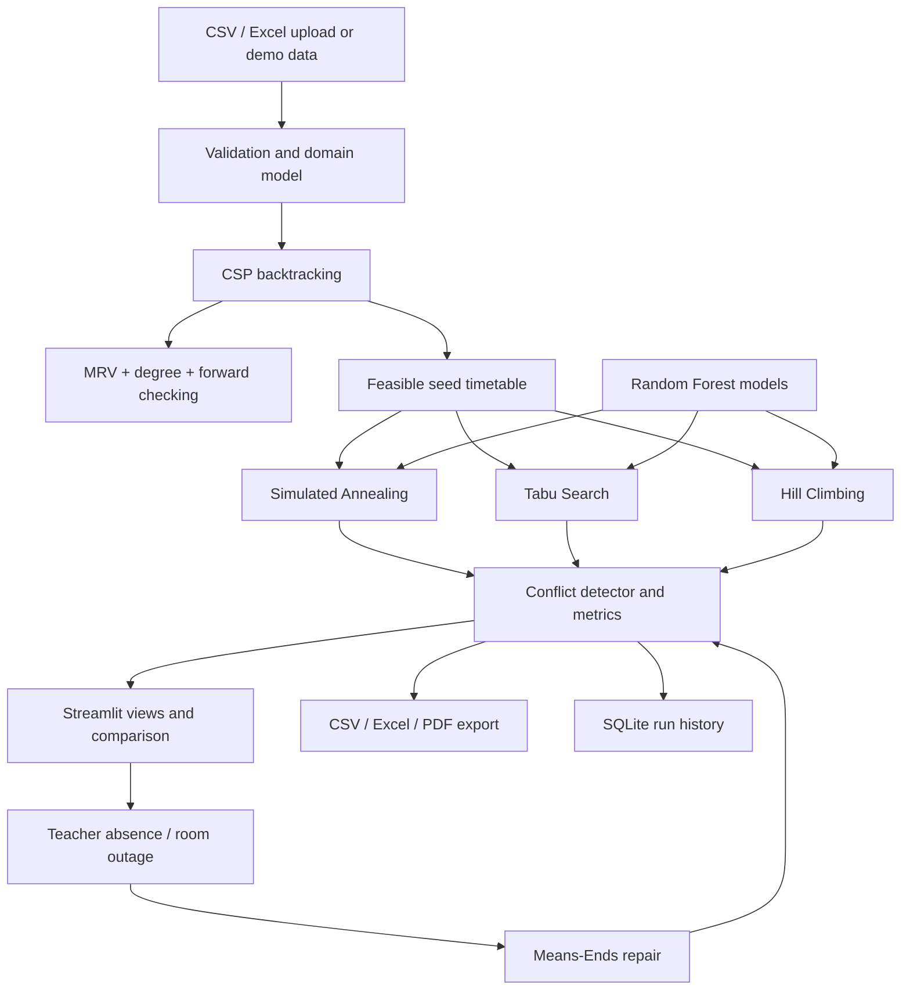

# IntelliSchedule AI

**AI-driven university timetable generation, optimization and disruption repair, built in Python with a Streamlit interface.**

IntelliSchedule AI builds conflict-free weekly timetables with a custom **Constraint Satisfaction (CSP)** solver, improves them with **metaheuristic search** (Simulated Annealing, Tabu Search, Hill Climbing), repairs them after disruptions with **Means-Ends Analysis**, and uses **Random Forest** models to estimate attendance and course demand.

> **Note on ML data:** the bundled demo data and the default Random Forest training data are **synthetic**. No real attendance or institutional records are included. Synthetic-only model scores are illustrative and do not show real-world accuracy. The app can train on your own historical files.

---

## Highlights

- **Hard-constraint guarantee:** no teacher, room or student-group clashes; room capacity and type; equipment; teacher availability and daily-hour limits; labs occupy two consecutive slots.
- **Custom CSP solver:** backtracking with dynamic MRV, degree tie-breaking and forward checking, bounded by node and wall-clock limits.
- **Three optimizers on one objective:** Simulated Annealing, Tabu Search and Hill Climbing, all starting from the same CSP seed and never accepting a hard-infeasible move.
- **Disruption repair:** teacher absence, changed availability, room closure, lab-equipment outage, enrollment increase, or a newly added class. Repairs are previewed first and applied only on request.
- **ML layer:** attendance and demand forecasting, with a separately trained preference-weight model.
- **Explainability:** objective breakdown, placement explanations and CSP diagnostics (nodes, backtracks, time).
- **Import and export:** CSV/Excel in; CSV, Excel and PDF out; SQLite run history.
- **Tested:** 18 unit tests covering the solver, optimizers, repair, exports, ML and validation.

---

## Interface

The app has eight workspaces, plus a Light/Dark theme switch in the sidebar.

| Tab | Purpose |
|---|---|
| ✦ Overview | Dataset summary and a live demo that runs the real CSP and Simulated Annealing on the 8-section sample |
| ◉ Generate | Build a feasible timetable with the CSP solver and view diagnostics |
| ↗ Optimize | Run and compare optimizers; per-iteration cost traces; Simulated Annealing controls (temperature, cooling, reheating, early stopping) |
| ◎ ML Insights | Holdout metrics, feature importance, weekday/time heatmaps, demand forecasts, ML Impact Explorer |
| ⟳ Repair | Disruption scenarios with changed-meeting count and disruption cost |
| ▦ Timetable | Group, teacher and room views; hard-conflict detection |
| ◫ Analytics | Idle periods, room utilization, teacher-load fairness |
| ⚙ Data | Upload, validate and manage datasets; run history |

The sidebar offers three data sources: **Demo campus** (110 sections), **Quick demo** (8 sections) and **Upload my data**.

---

## Quick start

Requires Python 3.10+.

**Windows (PowerShell)**

```powershell
py -m venv .venv
.\.venv\Scripts\Activate.ps1
py -m pip install -r requirements.txt
py scripts\generate_demo_data.py
py -m streamlit run app.py
```

**macOS / Linux**

```bash
python3 -m venv .venv
source .venv/bin/activate
pip install -r requirements.txt
python scripts/generate_demo_data.py
streamlit run app.py
```

The app loads the 110-section demo on startup. The demo campus has **110 sections (220 weekly meetings), 35 teachers, 10 student groups and 16 rooms**. The quick demo is a much smaller instance for fast experiments.

Run the evaluation and tests:

```bash
python scripts/evaluate.py                        # writes evaluation_report.md
python scripts/generate_project_documentation.py  # writes the 20-page PDF
python -m unittest discover -s tests -v           # 18 unit tests
```

---

## How it works



### 1. Problem model
Each meeting is assigned a **(day, start slot, room)**. The default week is Monday to Friday with eight one-hour slots from 08:00 to 16:00. Electives are modeled by listing several group IDs on one course (`G01|G02`); all listed groups are reserved together.

### 2. CSP solver (`timetable/constraints.py`)
Builds a domain of legal placements per meeting, picks the next variable by **minimum remaining values**, breaks ties by the number of conflicting unassigned variables, and **forward-checks** neighboring domains after each assignment. A node limit and timeout prevent unbounded search. Failure means "no solution found within the bound", not proof of infeasibility.

### 3. Soft-constraint objective (`timetable/optimizer.py`)
Optimizers minimize a weighted cost combining:

- student idle gaps
- daily-load variance per group
- adjacent heavy or same-subject classes
- teacher preference misses
- teacher idle gaps
- classroom-load balance
- teacher-load variance
- attendance-weighted slot utility (from the ML model)

The app shows the measured per-term breakdown, and the terms sum to the total cost.

### 4. Optimizers
- **Simulated Annealing:** single-meeting feasible moves, exponential cooling, Metropolis acceptance, adaptive neighborhood size, reheating, early stopping, and accepted/rejected-move diagnostics.
- **Tabu Search:** sampled feasible neighborhood, reverse-move tabu tenure, aspiration when a move beats the global best.
- **Hill Climbing:** best sampled feasible neighbor; stops after a stagnation limit.

Every final schedule is re-validated against the hard constraints.

### 5. Disruption repair (`timetable/reschedule.py`)
A bounded, CSP-guided **Means-Ends Analysis** heuristic compares the current schedule to the desired state and moves as few meetings as possible, allowing a small cascade to move a direct blocker. It does not guarantee a globally optimal repair.

### 6. Machine learning (`timetable/ml.py`)
- **Attendance model:** Random Forest on subject, weekday, time slot, enrollment, course type and previous attendance.
- **Demand model:** Random Forest on department, course type, historical enrollment, offered sections and elective flag.
- **Preference model:** trained *separately* from explicit `preference_feedback` rows. Attendance prediction never learns preference weights.
- Predicted demand is advisory only. **Room capacity always uses official enrollment.**
- Holdout is chronological when a `date` column exists, otherwise row order (last 20%).

---

## Measured results

From `scripts/evaluate.py` on the 220-meeting demo (seed 42, up to 150 iterations or 12 s per optimizer, same CSP seed for all):

| Algorithm | Initial cost | Final cost | Improvement | Student idle periods | Hard violations |
|---|---:|---:|---:|---:|---:|
| CSP seed (baseline) | 941.2 | 941.2 | 0.0% | 78 | 0 |
| Simulated Annealing | 941.2 | 884.9 | 6.0% | 58 | 0 |
| Tabu Search | 941.2 | 805.8 | 14.4% | 48 | 0 |
| Hill Climbing | 941.2 | 777.8 | 17.4% | 36 | 0 |

- CSP found a full schedule in 220 nodes with 0 backtracks (about 24.6 s wall time).
- On this instance and iteration budget, Hill Climbing reached the lowest cost. This is an instance-specific observation, not a universal ranking. Simulated Annealing is usually slower to improve under a small iteration budget; longer runs or tuned temperature/cooling may change the order.
- **ML holdout (synthetic data):** attendance MAE 0.039 (R² 0.59); demand MAE 5.8 students (R² 0.98). These describe the synthetic data process only.
- Results depend on hardware, package versions and the synthetic instance.

See `evaluation_report.md` for the full 10-section report.

---

## Input data

Upload one file per table (CSV, or Excel using the first worksheet). Filenames should be `courses`, `teachers`, `rooms`, `groups`, and optionally `attendance`, `enrollment`, `preference_feedback`.

| File | Required columns | Optional columns |
|---|---|---|
| `courses` | `course_id`, `teacher_id`, `group_id` or `group_ids` | `course_name`, `subject`, `department`, `enrollment`, `room_type` (`lecture`/`lab`), `duration` (1 or 2), `sessions_per_week`, `heavy`, `required_equipment` |
| `teachers` | `teacher_id` | `name`, `max_hours_per_day`, `available_slots`, `preferred_slots` |
| `rooms` | `room_id`, `room_type`, `capacity` | `equipment` |
| `groups` | `group_id` | `name`, `size` |

**Notes**

- `group_ids` accepts pipe- or comma-separated IDs. If `enrollment` is blank, the largest listed group size is used.
- Slot tokens use weekday and zero-based slot, e.g. `Mon:0|Tue:3`. A blank or `*` value in `available_slots` means all slots; a blank `preferred_slots` means no preference.
- Lab meetings always occupy two consecutive slots.
- Rooms may list pipe/comma-separated `equipment`; courses may require some via `required_equipment`.

**Optional ML history**

- `attendance`: `date`, `subject`, `weekday`, `time_slot`, `enrollment`, `course_type`, optional `previous_attendance`, target `attendance` (fraction or percent).
- `enrollment`: `date`, `department`, `course_type`, `historical_enrollment`, target `expected_enrollment`, optional `offered_sections`, `elective`.
- `preference_feedback`: `student_gaps`, `daily_load_imbalance`, `heavy_adjacent`, `teacher_preference_misses`, `teacher_gaps`, target `preference_rating` (at least 8 rows).

Example files are in `demo_data/` and `demo_data/quick/`.

---

## Project structure

```
app.py                      Streamlit UI (8 workspaces)
timetable/
  models.py                 Typed domain: Teacher, Room, Meeting, Placement, Problem
  constraints.py            Hard constraints, occupancy tracking, validation, CSP solver
  optimizer.py              Objective, metrics, SA / Tabu / Hill Climbing
  reschedule.py             Means-Ends disruption repair and disruption cost
  ml.py                     Attendance/demand forests, preference learning
  analytics.py              Constraint counts and placement explanations
  data.py                   CSV/Excel import, validation, Excel/PDF export
  storage.py                SQLite run, dataset and experiment history
scripts/
  generate_demo_data.py     Synthetic 110-section dataset generator
  evaluate.py               Reproducible algorithm comparison
  generate_project_documentation.py   20-page project PDF
tests/test_timetable.py     18 unit tests
demo_data/                  Full and quick demo CSV tables
evaluation_report.md        Measured evaluation report
IntelliSchedule_AI_Project_Documentation.pdf   Full project reference
```

**Tech stack:** Python, Streamlit, pandas, NumPy, scikit-learn, Plotly, openpyxl, ReportLab, SQLite.

---

## Limitations

- A deterministic weekly-slot **prototype**, not a production SIS/HR integration.
- Equal-length slots; no travel time, multi-campus distances or individual student enrollment lists; no accessibility-based room assignment.
- Random Forest models trained on synthetic data show process fit only. Real use needs governance, privacy review, feature engineering and validation.
- The CSP and repair searches are bounded and can fail on overloaded or poorly constrained data. CSP generation on the 220-meeting demo takes tens of seconds.
- Room utilization is scheduled seat-time divided by available room-hours, not actual occupancy.

## Roadmap

- Integrate authorized attendance and enrollment histories
- Add campus travel-time and room-accessibility constraints
- Benchmark on multiple real-world instances with multi-seed confidence intervals
- Benchmark the custom CSP against OR-Tools
- Speed up CSP generation for large instances

## Documentation

- `IntelliSchedule_AI_Project_Documentation.pdf`: architecture, algorithms, ML, scenarios, evaluation, tests and setup
- `evaluation_report.md`: measured algorithm comparison