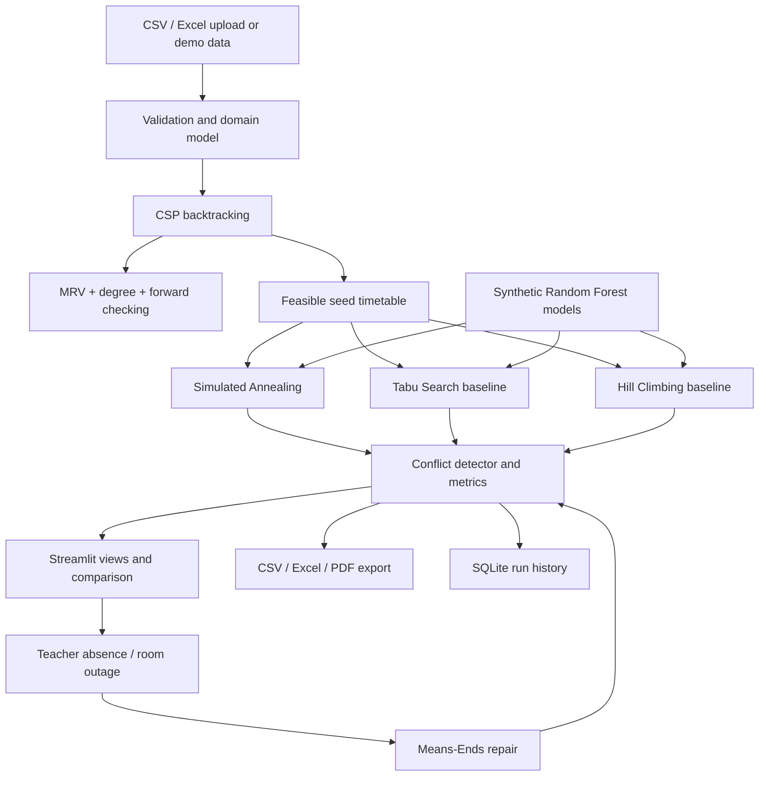

# IntelliSchedule AI – AI-Driven University Timetable Optimization and Predictive Scheduling

IntelliSchedule AI is a Python course project for generating conflict-free university timetables. It combines a custom CSP solver (backtracking, dynamic MRV, degree tie-breaking, and forward checking) with Simulated Annealing as the main soft-constraint optimizer. Tabu Search and Hill Climbing are comparison baselines; Means-Ends Analysis repairs schedules after staff or room disruptions.

> **Synthetic ML data:** the bundled demo and default Random Forest training data are synthetic; no real student attendance history or institutional records are included. The app can train on user-uploaded historical files. Synthetic-only model scores are illustrative and do not establish real-world accuracy.

## Features

- Hard constraints: no teacher, room, or overlapping student-group clashes; room capacity/type; two consecutive slots for labs; teacher availability and daily teaching-hour limits.
- Soft objective: reduce group timetable gaps and daily-load imbalance, avoid adjacent heavy/same-subject classes, respect teacher preferences, and favor slots with higher predicted attendance.
- Electives: a course may list multiple group IDs (`G01|G02`); all listed groups are reserved together.
- Import four CSV or Excel worksheets/files: `courses`, `teachers`, `rooms`, and `groups`.
- Group, teacher, and room timetable views, plus hard-conflict detection.
- Disruption repair for an absent teacher/day or unavailable room, minimizing changed meetings.
- Algorithm comparison with hard violations, soft score, runtime, and teacher-load fairness.
- CSV, Excel, and PDF exports; SQLite stores generated run history.
- Eight working workspaces: AI Command Center, Generation, Optimization Lab, ML Predictions, Rescheduling, Timetable Explorer, Analytics, and Data Management.
- Persistent in-session Light/Dark themes with explicit palette-aware tables and Plotly charts.
- A live 8-section homepage demonstration runs the actual CSP and Simulated Annealing, reports measured cost/idle-time changes, and lists any moved classes.
- Simulated Annealing exposes temperature/cooling controls, an adaptive feasible-neighborhood size, reheating, early stopping, and accepted/rejected-move diagnostics.
- Rescheduling scenarios are preview-only until explicitly applied; teacher absences, room/equipment outages, enrollment increases, and added classes use CSP-guided repair.
- An ML Impact Explorer compares optimized schedules with the attendance objective enabled and disabled while keeping other preference weights and hard constraints fixed.
- A measured objective breakdown and schedule-placement explanations expose the active soft-cost terms and checked local alternatives.
- CSP diagnostics include variable/constraint counts, search nodes, backtracks, and elapsed time. Search has node and wall-clock bounds; failures are reported explicitly.
- Optimization runs expose per-iteration current/best cost, accepted moves, stop reason, and runtime-bounded convergence data.
- The ML center reports chronological/row-order holdout MAE, RMSE, R², actual-vs-predicted values, feature importance, weekday/time heatmaps, and course-demand forecasts.
- Optional historical files can train attendance and demand models. Explicit `preference_feedback.csv` trains preference weights separately from attendance prediction.
- Rescheduling supports teacher absence, changed availability slots, room closure, a lab-equipment outage at a selected room, and adding a new class. It reports changed meetings and a disruption cost.
- A smaller 8-section quick-demo instance is provided alongside the 110-section demo.

## Quick start

```powershell
py -m venv .venv
.\.venv\Scripts\Activate.ps1
py -m pip install -r requirements.txt
py scripts\generate_demo_data.py
py -m streamlit run app.py
```

The app loads the 110-section demo on startup. In the sidebar, select **Quick demo** for faster experiments, or **Upload my data** to import university tables. The large instance contains 110 sections (220 weekly meetings), 35 teachers, 10 student groups, and 16 rooms. Both datasets are generated by `scripts/generate_demo_data.py`; CSV files are included under `demo_data/`.

Use the sidebar **Light / Dark** selector to switch the app's palette. On the Overview, the interactive demonstration runs on the included 8-section quick sample and does not replace the active timetable. A repair result is also shown as a preview; choose **Apply repaired timetable** only when you want to make it active.

Run the evaluation report and test suite:

```powershell
py scripts\evaluate.py
py scripts\generate_project_documentation.py
py -m unittest discover -s tests -v
```

The documentation generator writes `IntelliSchedule_AI_Project_Documentation.pdf`, a full 20-page
project reference covering the implemented architecture, algorithms, ML, scenarios, interface,
measured evaluation, tests, setup, and limitations.

## Input data schema

Upload one file per table. CSV is supported directly; Excel files use their first worksheet and the same column names.

| File | Required columns | Optional columns |
|---|---|---|
| `courses` | `course_id`, `teacher_id`, `group_id` or `group_ids` | `course_name`, `subject`, `department`, `enrollment`, `room_type` (`lecture`/`lab`), `duration` (1 or 2), `sessions_per_week`, `heavy`, `required_equipment` |
| `teachers` | `teacher_id` | `name`, `max_hours_per_day`, `available_slots`, `preferred_slots` |
| `rooms` | `room_id`, `room_type`, `capacity` | `equipment` |
| `groups` | `group_id` | `name`, `size` |

`group_ids` accepts pipe- or comma-separated group IDs. Slot restrictions use weekday and zero-based slot tokens, for example `Mon:0|Tue:3`. `available_slots` left blank or set to `*` means all slots; blank `preferred_slots` means no preference. The default week has Monday-Friday and eight one-hour slots from 08:00 to 16:00. If enrollment is blank, the largest listed group size is used.

Course rows may include `department` and `required_equipment`; room rows may include pipe/comma-separated `equipment`. Lab meetings always occupy two consecutive slots. Upload filenames should be `courses`, `teachers`, `rooms`, `groups`, or optionally `attendance`, `enrollment`, `preference_feedback` (CSV/Excel).

### Optional machine-learning history

- `attendance`: `date`, `subject`, `weekday`, `time_slot` (zero-based), `enrollment`, `course_type`, optional `previous_attendance`, and target `attendance` (fraction or percentage). Records are date-sorted when `date` exists; otherwise file row order is treated as history. The last 20% is held out for model metrics.
- `enrollment`: `date`, `department`, `course_type`, `historical_enrollment`, optional `offered_sections` and `elective`, and target `expected_enrollment`. The last 20% is held out for demand metrics.
- `preference_feedback`: numeric features `student_gaps`, `daily_load_imbalance`, `heavy_adjacent`, `teacher_preference_misses`, `teacher_gaps`, and target `preference_rating` (at least 8 rows). This trains a separate preference-weight model. Attendance predictions do **not** learn preference weights.

If historical data is absent, repeatable synthetic records train the Random Forests. Their holdout scores describe only that synthetic process and are not estimates of real institutional accuracy. Predicted demand is advisory; mandatory room capacity always uses official course enrollment.

## Architecture



## Algorithms and evaluation

The CSP solver creates a domain of legal room/day/start placements per meeting. It selects the next variable by minimum remaining legal values, breaks ties by the number of unassigned conflicting variables, and forward-checks neighboring domains after each assignment. An explicit node limit prevents unbounded search on infeasible inputs.

The optimizer changes one meeting at a time while preserving hard feasibility. The weighted objective combines student idle gaps, daily-load variance, adjacent heavy/same-subject classes, teacher preference misses, teacher idle gaps, room-load balance, teacher-load variance, and attendance-weighted slot utility. The exact values are available in the ML Predictions workspace. The Random Forests use a batched inference path so full demo optimization remains responsive.

`scripts/evaluate.py` runs all three optimizers from a shared CSP seed and writes a 10-section `evaluation_report.md` with measured cost improvement, idle periods, fairness, runtime, completed iterations, and hard-constraint validation. The app can export the report and per-run CSV reports. Results depend on hardware, package versions, and the synthetic instance; they are course-project measurements, not general performance guarantees.

## Project layout

```text
app.py                    Streamlit UI
timetable/
  constraints.py          Hard constraints, validation, CSP
  data.py                 CSV/Excel imports and exports
  ml.py                   Attendance/demand forests and explicit preference learning
  analytics.py            Constraint counts and factual decision explanations
  models.py               Typed scheduling domain
  optimizer.py            Objective, SA, Tabu, Hill Climbing
  reschedule.py           Means-Ends repair
  storage.py              SQLite run history
scripts/
  evaluate.py             Reproducible algorithm comparison
  generate_project_documentation.py  20-page project PDF generator
  generate_demo_data.py   Synthetic 110-section CSV generator
demo_data/                Included demo CSV tables
tests/                    Unit tests for core scheduling behavior
```

## Limitations

- This is a deterministic weekly-slot planning prototype, not a production SIS/HR integration.
- Electives are represented through overlapping group memberships; student-level enrollment lists and room assignment by accessibility are not modeled.
- Random Forest estimates are intentionally synthetic. Training on real data requires governance, consent/privacy review, feature engineering, and validation.
- The CSP node limit may be reached for overloaded or poorly constrained data; add capacity or revise constraints rather than treating an incomplete result as valid.
- Disruption repair is a bounded, CSP-guided Means-Ends heuristic. It preserves unaffected placements when feasible and allows a small cascade to direct blockers; it does not guarantee a globally optimal repair.
- The attendance and demand holdouts are chronological only when rows have a usable date/order. Synthetic validation is deliberately labeled and should not be presented as institutional model performance.
- The current room utilization statistic is scheduled seat-time divided by available room-hours; it does not represent actual seat occupancy or building energy use.
